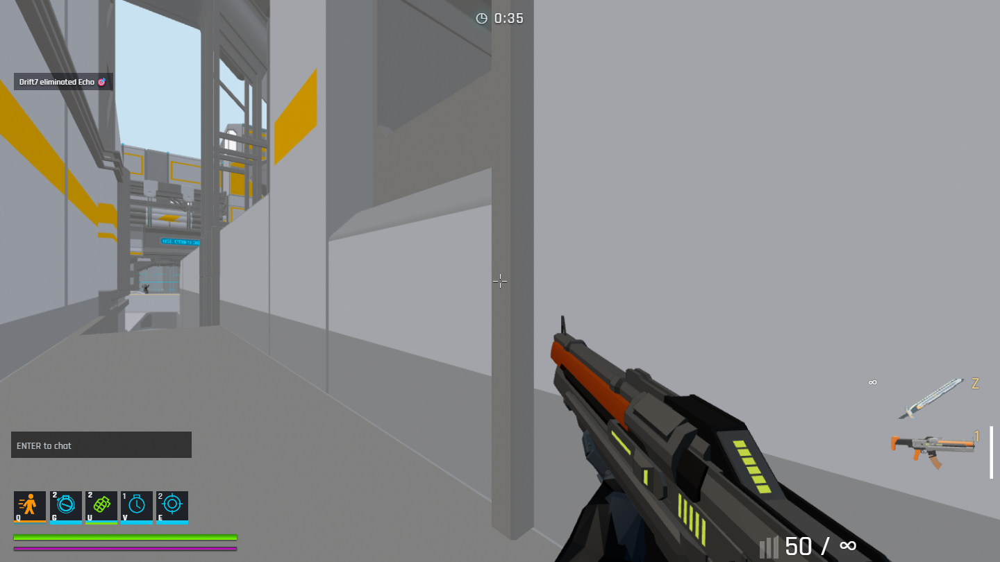
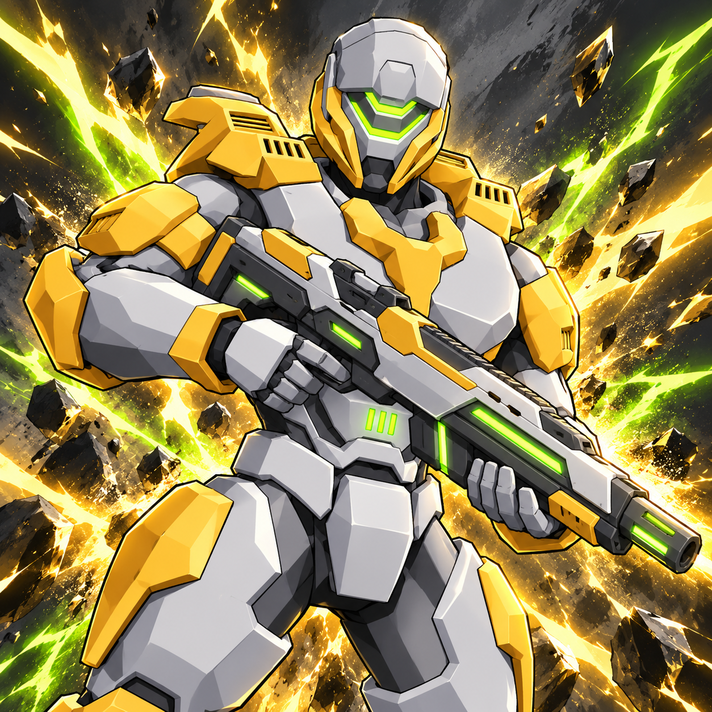
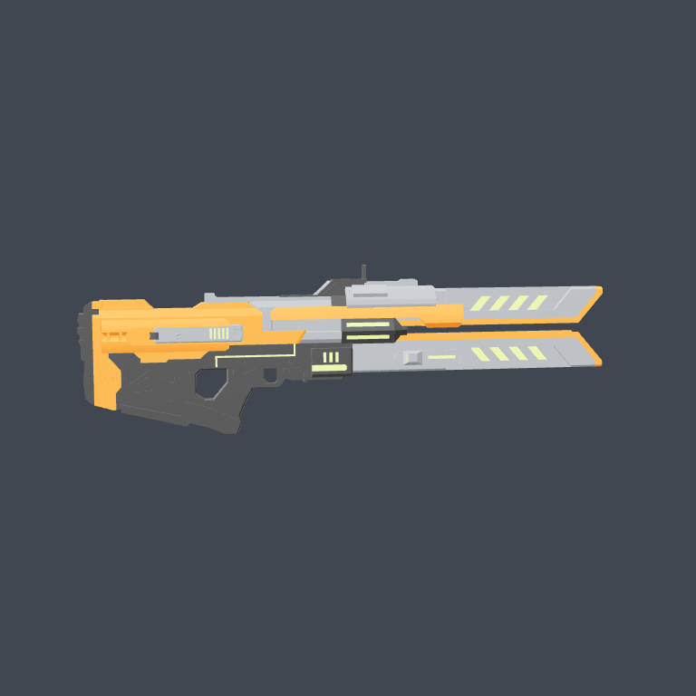

# KRYX

**A browser-based arena shooter built with Three.js and an authoritative Node.js multiplayer server.**

[Play KRYX](https://kryx.live/) · [Report an issue](https://github.com/NotHereButAfk/KRYX-public/issues) · [Server documentation](server/README.md)



## The game

Jump into free-for-all deathmatch with first-person combat, weapon pickups, and AI opponents. Customize your character and loadout through the in-game inventory.

- **Arena combat:** ranged weapons, melee, grenades, and movement abilities.
- **Multiplayer with bots:** the server handles movement and combat authority.
- **Character customization:** skin artwork, equipment previews, and loadouts.
- **Local guest play:** run the frontend and game server without production credentials.

Survival is temporarily disabled. Features that depend on hosted accounts or payments are not enabled in the local guest demo.

**Movement:** use WASD to move, hold Shift to run, and press **C while running** to slide. Ctrl crouches; Space jumps and can jump out of a slide.

### Current skin and weapon artwork

 

*Gameplay screenshot captured from this public build running locally on October 21, 2026; artwork is from the current game assets. Advertising and QA controls are excluded from the gameplay capture. The hosted release may differ while deployment is in progress.*

## Run locally

### Requirements

- Node.js **22.12 or newer**, with npm
- Git
- A modern browser with WebGL enabled

```sh
git clone https://github.com/NotHereButAfk/KRYX-public.git
cd KRYX-public
npm ci
npm ci --prefix server
npm start
```

Open the URL printed in the terminal, normally **http://127.0.0.1:5173**, and click to play. Keep the terminal running; press **Ctrl+C** to stop both services.

The launcher starts Vite and a local multiplayer server with bots. It selects a free backend port automatically and binds to your computer's loopback interface. Multiple browser tabs can join the same local server.

No database, wallet, Discord token, or environment file is required. Production accounts, saved progression, purchases, tournament services, and payouts are not connected to this local demo.

## Development commands

| Command | Purpose |
| --- | --- |
| `npm start` | Start the local frontend and game server |
| `npm run dev` | Alias for the combined local launcher |
| `npm run dev:client` | Start only the Vite frontend |
| `npm run build` | Build the frontend into `dist/` |
| `npm run test:viewmodel` | Check first-person weapon positioning and aim |
| `npm run test:player-respawn` | Check player state reset after respawning |

A frontend build alone does not start the multiplayer server. See the [server documentation](server/README.md) for optional backend configuration.

## Troubleshooting

- **Port already in use:** use the alternate URL Vite prints in the terminal.
- **Missing dependencies:** run both installation commands again, including `npm ci --prefix server`.
- **Blank or unsupported graphics:** confirm that browser hardware acceleration and WebGL are available.
- **Account services unavailable locally:** this is expected in guest mode; hosted credentials are intentionally excluded.

## Repository scope

This is the public source copy. Production development and deployment are maintained in a separate private repository; changes are published here separately. This repository does not include production secrets, private configuration, or deployment credentials.

When reporting a bug, include your browser, reproduction steps, and a screenshot or short recording. Do not include passwords, tokens, wallet recovery phrases, or other private data.

## Asset rights

Public repository access does not grant additional rights to third-party assets. Consult the existing asset notices and provenance documentation before redistributing models, artwork, or other bundled content.


